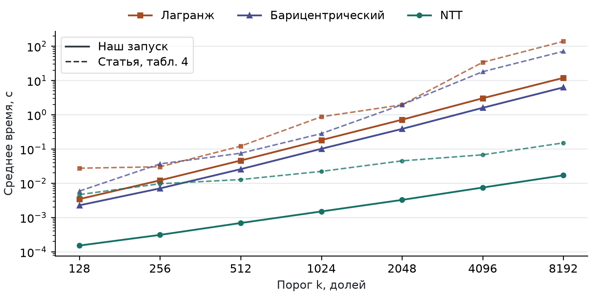

# Восстановление секрета при повреждённых и перепутанных долях

Проект по курсу «Защита информации», МФТИ, 2026.

Приложение шифрует файл с помощью AES-128-GCM и делит ключ по схеме Шамира «3 из 5». При восстановлении сравниваются два способа: взять первые три входных файла или перебрать тройки с разными индексами. Ключ каждой тройки проверяется по тегу зашифрованного контейнера.

Это позволяет восстановить файл, когда среди пяти входных файлов есть три корректные доли, а остальные повреждены или относятся к другому секрету. Для пяти файлов нужно проверить не более десяти троек.

## Запуск

Нужен Python 3.10 или новее с tkinter. Единственная внешняя зависимость приложения — PyCryptodome 3.23.0.

На macOS можно открыть `Запустить.command`. Скрипт найдёт Python с tkinter, создаст окружение в пользовательском каталоге кеша и установит зависимость. При необходимости путь к Python задаётся переменной `SHAMIR_PYTHON`.

Для запуска из терминала на macOS и Linux:

```sh
python3 -m venv .venv
.venv/bin/python -m pip install -r requirements.txt
.venv/bin/python -m shamir_project
```

В Windows:

```powershell
py -m venv .venv
.venv\Scripts\python.exe -m pip install -r requirements.txt
.venv\Scripts\python.exe -m shamir_project
```

В Linux tkinter может потребовать отдельной установки из пакетов дистрибутива. После установки PyCryptodome приложение работает локально.

## Работа с приложением

На вкладке «Шифрование» выберите файл размером до 32 МиБ и папку назначения. Приложение создаст отдельный каталог с контейнером `file.sssf` и пятью долями `share-1.json` — `share-5.json`.

На вкладке «Восстановление» загрузите контейнер и до пяти файлов долей. Кнопки «Выше» и «Ниже» меняют порядок входных файлов. После сравнения двух способов восстановленный файл можно сохранить.

На вкладке «Демонстрация» доступны готовые случаи. В примере «Две изменённые доли» первые три файла дают ошибочный ключ; перебор находит рабочую тройку №3, №4 и №5 на десятой попытке. Пример «Два значения с индексом 1» показывает обработку конфликтующих долей. В случае «Только две доли» приложение объясняет причину отказа.

## Результаты

В эксперименте проверены 17 сценариев на файлах размером 4 КиБ и 1 МиБ. Для каждого сценария перебраны все различные порядки входных файлов, по три повтора. В журнале 20 916 запусков. Каждый выданный файл сравнивался с исходным побайтно.

| Входной набор | Первые три файла | Перебор троек |
|---|---:|---:|
| Пять исправных долей | 120 / 120 | 120 / 120 |
| Одна изменённая доля | 48 / 120 | 120 / 120 |
| Две изменённые доли | 12 / 120 | 120 / 120 |

В таблице указаны успешные восстановления среди различных порядков входа. Результаты совпали для обоих размеров файла и всех трёх повторов. При двух ошибках и файле 1 МиБ медиана полного времени составила 8,6 мс для первых трёх файлов и 32,9 мс для перебора. Время включает чтение и запись; учтены как успехи, так и отказы.

Отдельно повторён эксперимент по интерполяции из статьи Ferreira и Borges. На параметрах раздела V сравниваются Лагранж, барицентрический метод и обратное NTT при порогах от 128 до 8192. Эйткен, Невилл, Ньютон и Вандермонд проверены на порогах 128 и 256. Подготовка таблиц и работа с готовыми таблицами измерены отдельно.



При пороге 8192 обычное обратное NTT заняло в среднем 17,0 мс, Лагранж — 11,9 с, барицентрический метод — 6,3 с с учётом подготовки. Это независимые реализации на разных машинах. NTT в этой серии использует специальную сетку узлов и восстанавливает все коэффициенты многочлена. В приложении с тремя произвольными долями используется библиотечный алгоритм Шамира на основе Лагранжа.

Исходные данные и описание столбцов находятся в [results](results/README.md). Измерения проведены на Apple M4 Pro, macOS 26.6.2, Python 3.12.14.

## Повторение измерений

Из корня репозитория:

```sh
.venv/bin/python benchmark_recovery.py --out my-results
.venv/bin/python benchmark_ieee.py --out my-results
```

В Windows замените `.venv/bin/python` на `.venv\Scripts\python.exe`. Новые файлы сохраняются в указанную папку. Полная серия занимает несколько минут.

Короткий запуск эксперимента по статье:

```sh
.venv/bin/python benchmark_ieee.py --out my-results --sizes 128 --repeats 1
```

Параметры `--extra-max` и `--memory-max` задают верхние пороги для дорогих методов и замеров памяти. Время измеряется через `perf_counter_ns`, память — отдельными запусками через `tracemalloc`.

## Материалы

- [Пояснительная записка](docs/Пояснительная%20записка.docx) — цель, результаты и распределение работы.
- [Результаты экспериментов](docs/Результаты%20экспериментов.docx) — таблицы, график и сравнение со статьёй.
- [Текст выступления](docs/Текст%20выступления.docx) — порядок доклада, демонстрация и вопросы.
- [Формат файлов и восстановление](shamir_project/core.py).
- [Интерфейс](shamir_project/__main__.py) и [демонстрационные случаи](shamir_project/demo.py).
- [Проверки восстановления](benchmark_recovery.py) и [эксперимент по статье](benchmark_ieee.py).

## Формат файлов

Контейнер содержит сигнатуру `SSSF` из четырёх байтов, байт версии, 16 байт идентификатора набора, 12 байт nonce, шифротекст и 16 байт тега AES-GCM. Заголовок аутентифицируется как связанные данные. Для каждого контейнера создаётся отдельный случайный ключ из 16 байт.

Файл доли — JSON с полями `v`, `set_id`, `x` и `y`. Индекс `x` лежит от 1 до 5; значение `y` записано 32 шестнадцатеричными знаками. Точные повторы определяются по паре `(x, y)`. Если одному индексу соответствуют разные значения, сохраняются оба кандидата, а в отдельную тройку попадает одно из них. Метка `set_id` используется для диагностики.

Для восстановления нужен исходный контейнер и минимум три корректные доли с разными индексами. Проверка тега даёт дополнительный способ проверить ключ-кандидат. При увеличении числа долей перебор сочетаний быстро дорожает. Доли предполагается хранить раздельно: доступ к трём долям позволяет расшифровать контейнер.

## Участники

| Участник | Часть проекта |
|---|---|
| Илья Шляпин | Криптографическое ядро, форматы файлов, восстановление ключа |
| Арслан Абдразаков | Интерфейс и демонстрационные случаи |
| Павел Уткин | Сценарии ошибок, проверки файлов и замеры восстановления |
| Булат Мотыгуллин | Эксперимент по статье IEEE и сравнение результатов |

## Источники

- Ferreira T. R. N., Borges F. *Performance Evaluation of Interpolation Techniques in Shamir Secret Sharing Scheme*. IEEE Access, 2026, vol. 14, pp. 50097–50108. [DOI: 10.1109/ACCESS.2026.3679331](https://doi.org/10.1109/ACCESS.2026.3679331).
- [PyCryptodome: Secret Sharing](https://www.pycryptodome.org/src/protocol/ss).
- [RFC 5116, § 5.1: AEAD AES GCM](https://www.rfc-editor.org/rfc/rfc5116.html#section-5.1).
