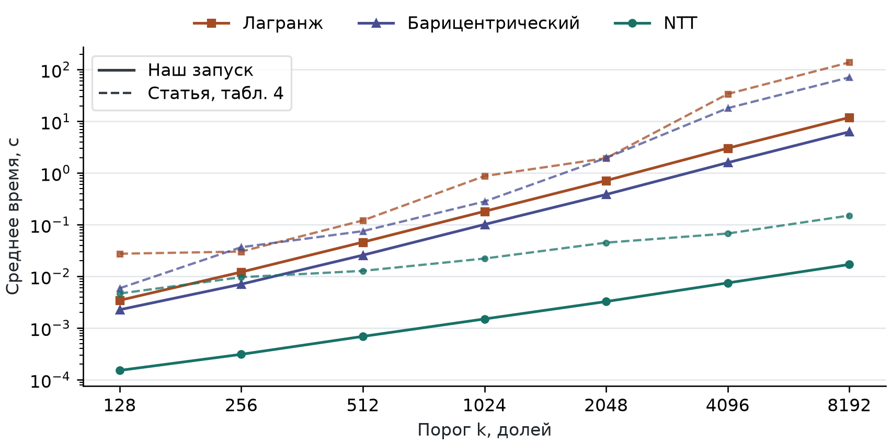

# Данные экспериментов

`recovery_runs.csv` содержит журнал сравнения первых трёх файлов и перебора троек. `ieee_timings.csv` и `ieee_memory.csv` содержат собственные измерения интерполяции. Файлы `ieee_reference.csv` и `ieee_reference_memory.csv` содержат значения из статьи Ferreira и Borges для сравнения. Настройки и сведения о машине сохранены в двух файлах `*_environment.json`.

## Восстановление файла

В `recovery_runs.csv` одна строка соответствует одному запуску метода на заданном порядке файлов.

| Столбец | Значение |
|---|---|
| `size_bytes` | Размер исходного файла в байтах |
| `scenario` | Сценарий из `shamir_project/demo.py` |
| `permutation` | Номер различного порядка входа в пределах сценария и размера |
| `order` | Имена файлов в порядке подачи |
| `repeat` | Номер повтора от 1 до 3 |
| `method` | `first` — первые три файла, `search` — перебор троек |
| `status` | Результат обработки; `ok` означает успешную проверку тега |
| `attempts` | Число проверенных троек |
| `matched_bytes` | `1`, если записанный файл совпал с исходным побайтно; иначе `0` |
| `search_ns` | Время восстановления после чтения и разбора входа, нс |
| `total_ns` | Полное время с чтением и, при успехе, записью файла, нс |

Для непрочитанного контейнера `search_ns` пуст. Проверка побайтного совпадения выполнялась после замера. Журнал включает все исходы, включая отказы. В нём 20 916 строк данных.

## Интерполяция

В `ieee_timings.csv` записаны порог `threshold`, общее число сгенерированных долей `shares`, номер повтора `repeat`, метод `method`, фаза `phase` и время `seconds` в секундах.

- `prepare` — подготовка коэффициентов или таблицы корней.
- `hot` — восстановление с готовой таблицей.
- `cold` — восстановление с учётом подготовки; для методов без отдельной подготовки это один полный запуск.

Для Лагранжа, барицентрического метода и NTT с таблицей значение `cold` равно сумме `prepare` и `hot`. По каждой конфигурации выполнено десять повторов. Все методы получали одни и те же точки.

В `ieee_memory.csv` столбец `peak_python_bytes` содержит пик Python-аллокаций одной операции по `tracemalloc`. Эти замеры выполнены отдельно от измерений времени и охватывают только выделения, учитываемые `tracemalloc`.

Опубликованные значения взяты из таблиц 2, 3 и 4 [статьи](https://doi.org/10.1109/ACCESS.2026.3679331). Ссылка на конкретную таблицу записана в столбце `table`. В `ieee_reference.csv` время `original_seconds` задано в секундах. Единицы памяти указаны в названии столбца `ieee_reference_memory.csv`.

На графике показано среднее время с учётом подготовки. Сплошные линии соответствуют нашим измерениям, пунктирные — статье. Обе оси логарифмические.
